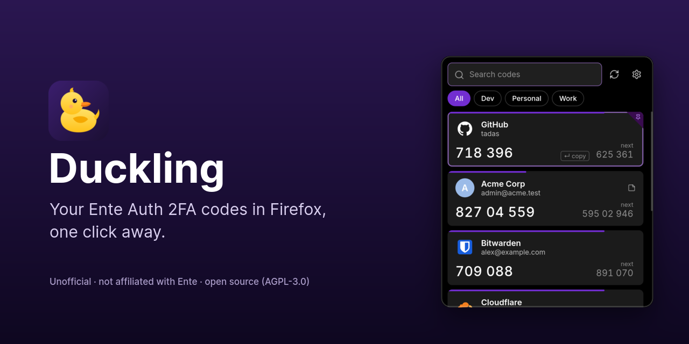
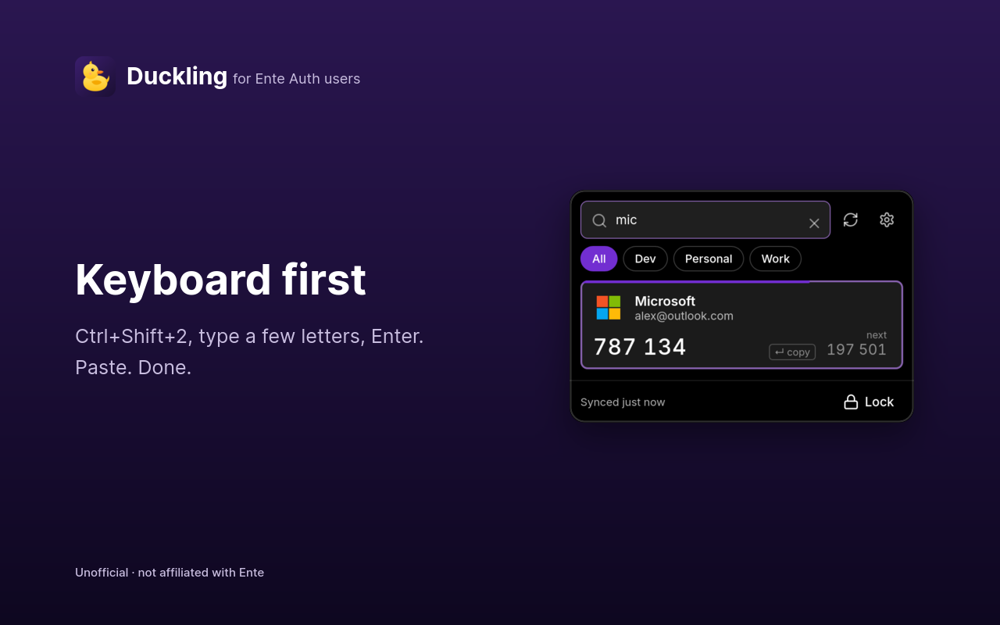
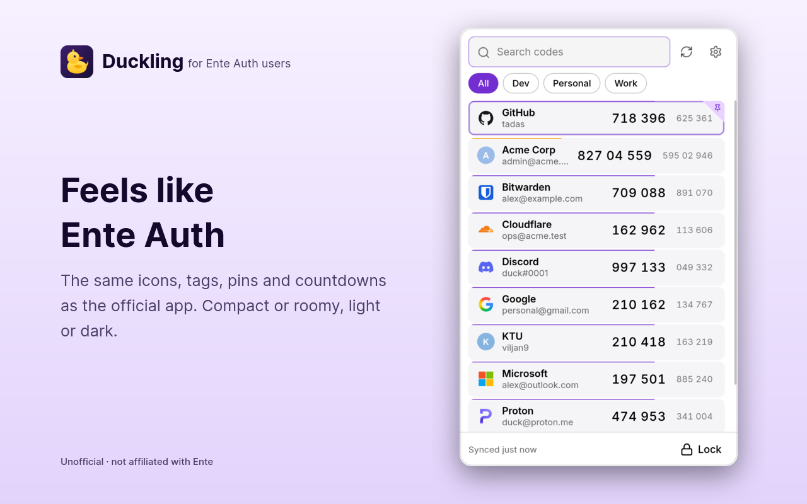
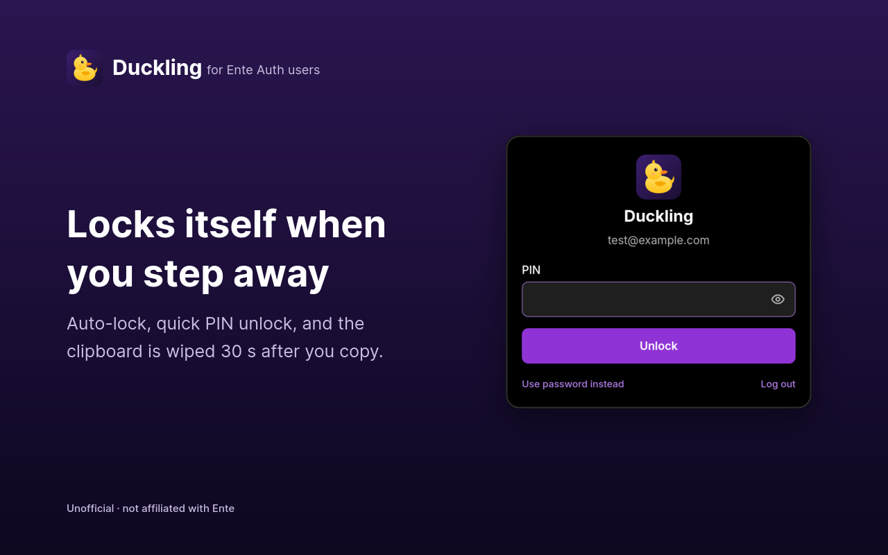
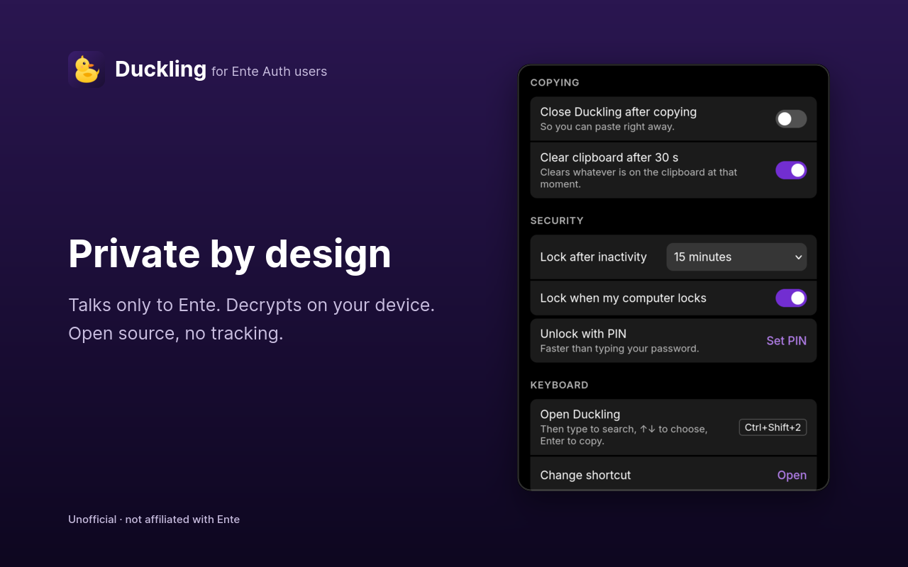

<p align="center">
  
</p>

<p align="center">
  <a href="https://addons.mozilla.org/firefox/addon/duckling-ente-auth/"></a>
  
  <a href="LICENSE"></a>
  
</p>

<p align="center">
  <b>Duckling</b> shows the 2FA codes from your <a href="https://ente.com/auth">Ente Auth</a> account right in Firefox,<br>
  so you don't have to reach for your phone.
</p>

> [!NOTE]
> Duckling is an **unofficial** community project. It is not made by, affiliated with, or endorsed by Ente.
> You need an existing Ente Auth account. Duckling only reads your codes and never changes your account.

## ✨ Features

- **Codes for the site you're on come first.** Open Duckling on GitHub and your GitHub code is at the top. Matching uses the real domain, so lookalike phishing sites don't get your code.
- **Keyboard first.** <kbd>Ctrl</kbd>+<kbd>Shift</kbd>+<kbd>2</kbd>, type a few letters, <kbd>Enter</kbd>, paste. Duckling closes itself after copying.
- **Feels like Ente Auth.** The same service icons, tags, pinned codes, countdown bars and "next" code as the official app. Light and dark theme, compact list.
- **Locks itself.** After inactivity (default 15 min), when your computer locks, and when Firefox closes. Unlock with your password or an optional PIN.
- **Clipboard hygiene.** Copied codes are wiped from the clipboard after 30 seconds.
- **Everything Ente Auth supports:** TOTP, HOTP, Steam Guard, 8-digit codes, any period, and self-hosted Ente servers.

<table>
  <tr>
    <td></td>
    <td></td>
  </tr>
  <tr>
    <td></td>
    <td></td>
  </tr>
</table>

## 🚀 Install

**From Firefox Add-ons:** coming soon. Version 1.0.0 is awaiting Mozilla's review.

**From source** (until then):

1. Build it: see [BUILDING.md](BUILDING.md) (`npm ci && npm run build`).
2. Open `about:debugging#/runtime/this-firefox` in Firefox.
3. Click **Load Temporary Add-on…** and pick `.output/firefox-mv3/manifest.json`.

Works on Firefox 140 and newer, including Firefox ESR.

## ⌨️ Using Duckling

| Do this | To |
| --- | --- |
| <kbd>Ctrl</kbd>+<kbd>Shift</kbd>+<kbd>2</kbd> (<kbd>⌘</kbd>+<kbd>Shift</kbd>+<kbd>2</kbd> on Mac) | Open Duckling (change it in Settings → Keyboard) |
| Type | Search by name, account, note or tag |
| <kbd>↑</kbd> <kbd>↓</kbd> | Choose a code |
| <kbd>Enter</kbd> / click | Copy the code |
| <kbd>Shift</kbd>+<kbd>Enter</kbd> / click "next" | Copy the next code |
| <kbd>Esc</kbd> | Clear the search, or close Duckling |

## 🔒 Security and privacy

- **Your password never leaves your device.** Login uses SRP, the same zero-knowledge protocol as Ente's own apps, with email verification and two-factor login supported.
- **Your codes stay end-to-end encrypted.** They're decrypted only on your device, and nothing decrypted is ever written to disk. Only the key that unlocks your codes is kept, in memory. Your Ente master key is wiped right after login.
- **Talks only to Ente.** No analytics, no tracking, no remote code. The developer receives nothing.
- **Open and checkable.** Every cryptographic step cites the matching file in Ente's [open-source code](https://github.com/ente-io/ente), the login code is tested against Ente's own server test vectors, and the build is byte-for-byte reproducible.

Read the full [privacy policy](PRIVACY.md) for exactly what is stored and sent.

<details>
<summary><b>Details: what is stored where</b></summary>

| Where | What | Cleared |
| --- | --- | --- |
| Disk (`storage.local`) | Session token, settings, email, and **encrypted** data only (Ente's key attributes, the encrypted authenticator key, encrypted 2FA entries) | On logout |
| Memory (`storage.session`) | The decrypted authenticator key; with a PIN, a PIN-encrypted copy | On lock (the key) or when Firefox closes |
| Nowhere | Your password, master key, private key, decrypted codes | Wiped right after use |

- **Fast unlock:** like Ente's web app, Duckling keeps a second copy of your encrypted master key behind a lighter (64 MiB) password derivation, so unlocking takes under a second instead of several. A strong Ente password keeps this safe.
- **PIN:** a PIN never protects anything on disk. The PIN-encrypted key lives only in memory; after Firefox restarts, or after 5 wrong PINs, your password is required.
- **Clipboard:** Duckling can't read your clipboard, so 30 s after a copy it clears whatever is there (you can turn this off).
- **CSP:** only the extension's own scripts run. `wasm-unsafe-eval` lets libsodium compile its WebAssembly (needed for Argon2id); it does not allow JavaScript `eval`.

</details>

## 🔑 Permissions

| Permission | Why |
| --- | --- |
| `storage` | Keep your encrypted codes, session and settings; keep the unlocked key in memory-only storage. |
| `activeTab` | Read the current tab's address *when you open Duckling*, to show that site's codes first. No access to page content. |
| `alarms` | Auto-lock and clipboard timers. |
| `idle` | Lock when your computer locks. Duckling only learns "active / idle / locked". |
| `clipboardWrite` | Clear the clipboard 30 s after copying, after the popup has closed. |

No host permissions: Duckling can't read or change any website.

At install, Firefox will say Duckling handles **authentication information** and **personally identifying information**. That's your email and login proof, sent only to your own Ente account to log you in.

## ❓ FAQ

**Is this an official Ente app?**
No. It's an independent open-source project that uses Ente's public API, the same one the official apps use.

**Can I add or edit codes?**
Not yet. Duckling is read-only; add and edit codes in the Ente Auth app and they appear after a sync.

**My Ente account uses a passkey for two-factor login.**
Passkeys aren't supported yet. Add an authenticator-app (TOTP) second factor to your Ente account to log in with Duckling.

**Does it autofill codes into websites?**
Not yet. That's planned, along with Firefox for Android and a Chrome version.

**I self-host Ente.**
On the login screen, click "Using a self-hosted Ente server?" and enter your server's address.

## 🛠 Development

```sh
npm ci
npm run dev          # live reload in a temporary Firefox profile
npm test             # unit + end-to-end tests (no network needed)
npm run fake-server  # a fake Ente server, so you can try every screen without an account
npm run release      # tests, type-check, AMO zip, lint and source archive
```

Fake server login: server `http://localhost:8787`, email `test@example.com`, password `hunter2-but-longer`, 2FA code `123456`.
Build and reviewer details are in [BUILDING.md](BUILDING.md).

## 🙏 Credits

- Protocol and crypto logic ported from [ente-io/ente](https://github.com/ente-io/ente) (AGPL-3.0). Thank you, Ente team.
- Service icons: Ente Auth's custom icons (AGPL-3.0) and [Simple Icons](https://simpleicons.org) (CC0-1.0). Logos are trademarks of their owners and are used only to identify services.
- Interface icons: [Lucide](https://lucide.dev) (ISC). Font: [Inter](https://rsms.me/inter/) (OFL-1.1).

## 📄 License

[AGPL-3.0](LICENSE). The duckling icon is original artwork made for this project.
